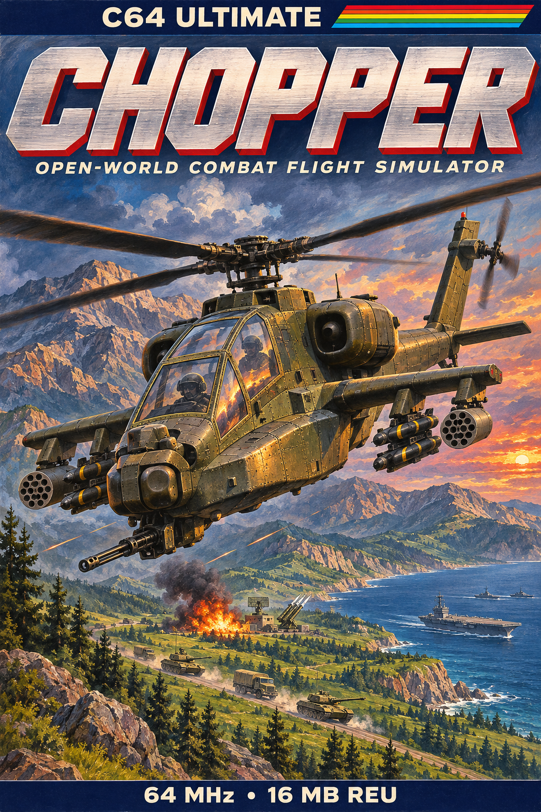

# Chopper

<p align="center">
  
</p>

**An open-world combat flight simulator for the Commodore 64 Ultimate.** An island at war, simulated
whole: hundreds of platoons manoeuvring, fighting and learning in real time, and one attack helicopter
in the middle of it, yours. It runs on the Commodore 64 Ultimate, using its 64 MHz turbo and its 16 MB virtual REU.


## Real-time simulation

You begin on the deck of the carrier, offshore, with the rotor spooling up and the tach climbing.
Eighty seconds later the RPM caution goes out, and where you take the war is up to you.

- **The war is the game.** Nothing in it is scripted. The simulation holds 480 platoons of up to ten
  vehicles each, on both sides of a front that runs the length of the island: convoys on the
  roads, armour at the outposts, SAM sites in the valleys, a carrier group offshore, gunships on
  patrol. Every platoon moves, chooses and fights on its own account, every few seconds, whether you
  are there or not. Outposts fall to whoever holds their ground in strength, the roads of
  reinforcement follow the front, and every thirty seconds the director reinforces whichever side has
  fallen below strength, a fresh wave up the road. Wrecks burn where they fell. It opens with five
  hundred vehicles ashore and afloat and reinforces, wave after wave, into the thousands.
- **Fly close and it resolves.** Within two and a half kilometres a platoon becomes its vehicles in
  formation: a staggered column on the move, a line abreast in contact, a V in the air. Beyond that,
  fights within three kilometres still show on the horizon as muzzle flashes and impacts, and the
  closer fight takes precedence for the screen's effects.
- **A gunship with inertia.** The flight model is the autopilot's own, with your stick in place of its
  decisions: bank and pitch lag the input, speed builds and bleeds off, and the aircraft rolls into
  every turn. Collective and trim are handled for you: it holds a cruise height over the terrain and
  climbs the ridge by itself. Hold back at a hover and it lands, anywhere, including the carrier's
  deck, which then carries you with it. Push forward to lift off. Speed is armour: at three
  quarters of full speed and above, a platoon's volley is half as likely to find you.
- **Guns and missiles.** The gun fires along the boresight at ten bursts a second, each with a tracer,
  out to 640 m: walk the stream onto the target. Eight missiles, fire and forget. The diamond on the
  HUD is the seeker's field of view: an enemy inside it within two kilometres arms the system, the
  seeker slides onto it, closes over a second and a half and reports `LOCK`, and from then on the
  missile does the flying. The lock is on the vehicle, not its place in the list, so a formation
  shuffling its order never resets it. Damage spills through a platoon: one missile into a truck
  column takes five trucks with it.
- **An order of battle that learns.** Trucks, APCs, tanks, flak guns, SAM sites with their radars,
  gunboats, missile boats, gunships, and a carrier with its destroyers, each with its own speed,
  armour, weapon, reload and turning circle. What they do with them is not fixed. Every platoon walks
  a decision tree planned offline by GOAP, and wherever two plans are nearly as good the tree holds a
  learned byte that tips the choice. Every outcome, damage dealt against damage taken, nudges that
  byte toward what worked. The weights are shared by kind across the whole island, so each tank learns
  from every tank's fights, including the ones on your side. The longer the war runs, the better they
  get. Flak, SAMs, the boats, the gunships and the fleet's own air defence fire on aircraft; tanks and
  APCs cannot elevate to reach you, which makes an armoured column the most satisfying target on the
  island.
- **Sound in three dimensions, on four SIDs.** Your own rotor is a recording, streamed from the REU
  through the C64U's sampler. Everything else plays on the C64U's two UltiSIDs split into four chips,
  one chip per ear per sound, and is placed through a head-related transfer function in all three axes:
  an interaural delay of up to 0.64 ms, a level difference of up to 10.5 dB, and the head's shadow as a
  low-pass on the far ear, worked from the source's bearing, elevation and distance, recomputed every
  frame and slewed at 60 Hz in the raster interrupt. Bank, and the ears tilt with you. A sound behind
  you is muffled; a battle three kilometres off is quiet and dull. The two nearest vehicles run their
  engines, revving as they move and Doppler-shifting as they pass, and the carrier's diesel throbs
  across the water.
- **A cockpit, not a dashboard.** Six instruments under the view: airspeed in knots, attitude, altitude
  in feet, a dual tachometer, heading and vertical speed, with cautions for rotor RPM, low altitude,
  the autopilot and open sea. Over the view, a head-up display: the boresight, a waypoint caret with
  its range in kilometres that points off-screen to a waypoint behind you, brackets on up to eight
  targets, and the seeker diamond. A hit shakes the whole picture and flashes the frame red.
- **The autopilot is a combatant, not a demo.** Leave the stick alone and an AI pilot flies the same
  aircraft by the same controls, from its own learned tree: it hunts the nearest enemy within two
  kilometres, strafes, launches on lock, and goes home at half damage or with its missiles gone, to be
  rearmed and repaired on the pad. Touch any control and the aircraft is yours, mid-manoeuvre. Let go
  in flight and your copilot, the same pilot, holds your course and keeps you off the mountains. Shot
  down or ditched, you are back on the deck or the pad, and the war has not waited for you.


## Controls

One joystick in port 2 (two buttons), or the keyboard:

| | Joystick | Keyboard |
|---|---|---|
| Accelerate / decelerate to a hover | forward / back | W / S |
| Turn (the aircraft banks itself) | left / right | A / D |
| Gun | fire | SPACE |
| Missile, at the locked target | second button | SHIFT |
| Land | hold back at a hover | S |
| Lift off | forward | W |

Height is the pilot's: it holds cruise and climbs over whatever is ahead.

## Playing it

You need a **Commodore 64 Ultimate** with its **16 MB virtual REU** enabled. Prebuilt releases aren't published yet, so
build from source (below), then:

```
python tools/c64u.py config                 # config/chopper.cfg: four SIDs, the mixer
python tools/c64u.py upload-reu dist/chopper.reu
python tools/c64u.py run dist/chopper.prg
```

`config/chopper.cfg` splits the C64U's two UltiSIDs into four SIDs (two left, two right) and sets the
audio mixer; the full stereo field depends on it. Without HDMI audio, `config/chopper-internal-speaker.cfg`
adds the built-in speaker. The tools find the C64U at `C64U_HOST` (default `192.168.66.178`).

## Under the hood

- The ground is a "mode 7" perspective plane fetched one REU DMA per bitmap byte, with flat-shaded 3D
  objects streamed over it from the REU. Clouds, smoke and explosions are sprites; the HUD is a
  raster-IRQ sprite multiplexer.
- The simulation lives in the REU: 480 platoon records of 32 bytes, paged through RAM 48 at a time and
  stepped round-robin, so the war's cost is in records, not vehicles.
- Rust (rust-mos / llvm-mos) and 6502 assembly. Most of the code is not resident: it lives in the REU
  and is fetched into three windows as overlays, in a fixed order, each frame.
- The same Rust core builds for the PC, where it renders every frame byte for byte as the C64 does. The
  test gate runs the C64 program in a 6502 emulator and checks every shown frame against the PC's.

More detail:
- [docs/design.md](docs/design.md): the game and engine design.
- [docs/validation.md](docs/validation.md): what was measured, on the model and on hardware.
- [CLAUDE.md](CLAUDE.md): building, the test gate and the hardware tools.

## Credits

The renderer comes from the same author's mode7 project, which builds on TALON HD. The decision trees
follow impact's format, and the sound codec comes from sueme64. Clouds and effects are from Ludo.ai
source art. See [THIRD-PARTY.md](THIRD-PARTY.md).

## License

[MIT](LICENSE). The third-party code and assets listed in [THIRD-PARTY.md](THIRD-PARTY.md) keep their
own terms.
