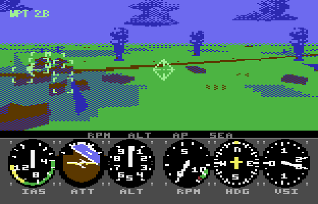
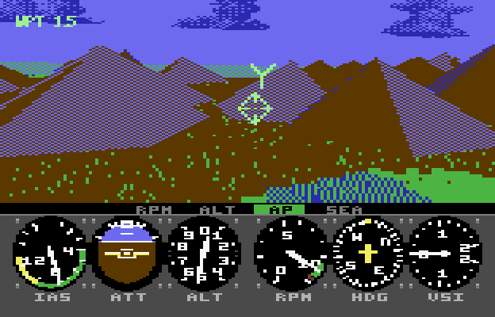

# Chopper

**A helicopter war for the Commodore 64 Ultimate.** Fly a gunship over an island where a whole war is
being fought, on real C64 hardware (the C64U's 64 MHz turbo and a 16 MB REU).



## Real-time simulation

- **A whole war, not a stage set.** 480 units on both sides, a thousand to two thousand vehicles in
  their platoons, fighting across the island whether you're there or not. Reinforcements come ashore on
  the north beachhead and fly in from home base. Sectors change hands, and wrecks stay where they fell,
  burning. Fly close and a platoon becomes its trucks, tanks and gunboats in formation. Out on the
  horizon, muzzle flashes show a battle you haven't reached yet.
- **Fly a powerful gunship.** One stick does it all. Push to speed up, pull back to hover, and steer
  left and right: the helicopter banks into its turns, holds its height and climbs over the mountains by
  itself. To land, hover over an H and it settles on. Starting up, you watch the rotor spool up with the
  tach. Banks and pitches lag, and speed builds and bleeds off.
- **Guns and missiles.** 600 rounds, with tracers that show where your stream is going. Missiles are
  fire and forget: put an enemy in the diamond and the seeker arms, slides onto the target, closes in
  and calls `LOCK`.
- **Enemies that learn.** Trucks, APCs, tanks, flak guns, radar-cued SAM sites, gunboats, missile boats
  and enemy gunships. Every kind shares a brain that keeps learning from what worked as the war goes on
  (and so do your allies). They aim like people do, with a reaction time and a lead that misses on a
  fast crossing. Their radars can't see through rock, so fly low behind the ridge.
- **Sound all around you.** The real rotor, sampled, plus effects and engines on four SIDs, placed in
  3D. A tank grinding on your left stays on your left as you turn. A gunship passing overhead swings
  from ear to ear, and a convoy's engines drop in pitch as you pass it. Fire behind you sounds muffled.
  Then there's the carrier's huge diesel throb.
- **A real cockpit.** Six round gauges and the caution lamps. Over the view sits a head-up display:
  boresight, waypoint caret, target brackets that flash when an enemy fires, and the lock-on diamond. A
  hit shakes the whole screen.
- **Take over any time.** In attract mode, an AI pilot flies the same helicopter as a full combatant: it
  hunts, hides from SAMs, and goes home to rearm and repair. Touch the stick and it's yours. Let go and
  your copilot holds the course.



## Controls

One joystick in port 2 (two buttons), or the keyboard:

| | Joystick | Keyboard |
|---|---|---|
| Speed up / slow to a hover | forward / back | W / S |
| Turn (it banks by itself) | left / right | A / D |
| Gun | fire button | SPACE |
| Missile (at the locked target) | second button | SHIFT |
| Land | hover over a pad's H | |
| Lift off | forward | W |

## Playing it

You need a **C64 Ultimate** with its **16 MB REU** turned on. Prebuilt releases aren't published yet,
so build from source (below), then:

```
python tools/c64u.py config                 # config/chopper.cfg: four SIDs, the mixer
python tools/c64u.py upload-reu dist/chopper.reu
python tools/c64u.py run dist/chopper.prg
```

For the full stereo effects, `config/chopper.cfg` splits the C64U's two UltiSIDs into four SIDs (left
and right) and sets the audio mixer. If you have no HDMI audio, `config/chopper-internal-speaker.cfg`
sets up the built-in speaker. The tools find the C64U at `C64U_HOST` (default `192.168.66.178`).

## Under the hood

- A "mode 7" ground plane drawn one REU DMA per byte, with flat-shaded 3D objects streamed over it.
  Clouds, smoke and explosions are sprites, and the HUD is a raster-IRQ sprite multiplexer.
- It's written in Rust (rust-mos / llvm-mos) and 6502 assembly. Most of the code lives in the REU and is
  paged into memory as overlays.
- The same Rust core also builds for the PC, where it renders every frame byte for byte as the C64
  does. A 6502 emulator checks the two against each other.

More detail:
- [docs/design.md](docs/design.md): the game and engine design.
- [docs/validation.md](docs/validation.md): what was measured, on the model and on hardware.
- [CLAUDE.md](CLAUDE.md): building, the test gate and the hardware tools.

## Credits

The renderer comes from the same author's mode7 project, which builds on TALON HD. The decision trees
follow impact's format, and the sound codec comes from sueme64. Clouds and effects are from Ludo.ai
source art. See [THIRD-PARTY.md](THIRD-PARTY.md).

## License

[MIT](LICENSE). The third-party code and assets listed in [THIRD-PARTY.md](THIRD-PARTY.md) keep their
own terms.
